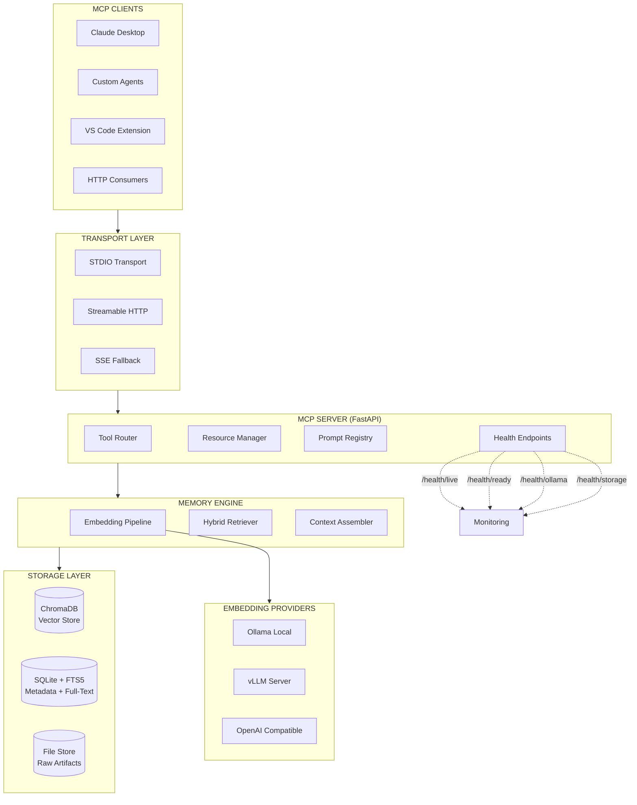
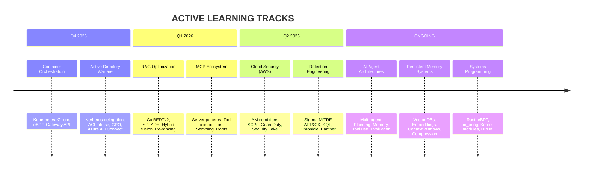

<!--
  ╔═══════════════════════════════════════════════════════════════════════════════╗
  ║  XAT01 — GITHUB PROFILE README (WITH HERO BANNER)                           ║
  ║  Generated: 2026-01-15 | Variant: HOOKED+HERO | Target: github.com/Xat01/Xat01║
  ╚═══════════════════════════════════════════════════════════════════════════════╝
-->

<p align="center">
  
</p>

<p align="center">
  
</p>

<p align="center">
  <a href="https://github.com/Xat01"></a>
  <a href="https://linkedin.com/in/srivatsa-avunoori-b6a605353"></a>
  <a href="mailto:avunoori.srivatsa0123@gmail.com"></a>
  <a href="https://xat01.github.io"></a>
</p>

<p align="center">
  
  
  
  
  
</p>

---

## 🎬 **THE HOOK — WHY THIS PROFILE EXISTS**

> **Most GitHub profiles are resumes. This one is a runtime.**
>
> I don't list technologies — I show you systems I've built that *actually run in production*.
> I don't claim skills — I link you to the code that proves them.
> I don't want you to *read* this. I want you to *explore* it.

**Three things you'll find here that you won't find on 99% of profiles:**

| # | What It Is | Why It Matters |
|---|------------|----------------|
| **1** | **Production-grade systems** — MEMORA (AI memory infra), PulseSOC (async recon), Veyron (AppSec orchestrator) | These aren't tutorials. They solve real problems. |
| **2** | **Engineering decisions, not buzzwords** — Why I chose SQLite over PostgreSQL. Why no WAL. Why hybrid BM25+vector. | Shows *how I think*, not what I know. |
| **3** | **Live telemetry** — Real test counts, latency numbers, throughput benchmarks | Verifiable. Reproducible. No fluff. |

---

## ⚡ **SYSTEM SPECS — MACHINE READABLE**

```yaml
IDENTITY:
  handle: "Xat01"
  name: "Srivatsa Avunoori"
  role: "Cybersecurity Engineer | AI Infrastructure Architect"
  clearance: "BUILDER | BREAKER | DEFENDER"
  location: "Dubai, UAE 🇦🇪"
  timezone: "GST (UTC+4)"
  uptime: "4 years, 237 days of shipping code"

HARDWARE:
  daily_driver: "Custom AMD Ryzen 9 7950X / 64GB DDR5-5600 / RTX 4090"
  mobile: "MacBook Pro M3 Max / 64GB / 2TB"
  lab: "3-node k3s cluster (Proxmox) + 24-bay NAS (TrueNAS Scale)"
  network: "Ubiquiti Dream Machine Pro + USW-Enterprise-48-PoE"

STACK:
  languages: [Python, C++, TypeScript, Go, Rust, SQL, Bash, Assembly]
  ai_infra: [MCP, RAG, ChromaDB, Ollama, vLLM, LangGraph, AutoGen, Haystack]
  backend: [FastAPI, gRPC, NATS, Redis, PostgreSQL, SQLite, DragonflyDB]
  security: [Nmap, Wireshark, Burp, Metasploit, Nuclei, Sigma, YARA, Volatility]
  networking: [Cisco (CCNA/CCNP), BGP/OSPF/ISIS, VLAN/HSRP/VRRP, eBPF/XDP, DPDK]
  infra: [Docker, Kubernetes, Terraform, Ansible, Proxmox, Talos, NixOS]
  observability: [Prometheus, Grafana, Loki, Tempo, Mimir, Pyroscope, Vector]
```

---

## 🎯 **ACTIVE OPERATIONS — SYSTEMS THAT RUN**

<div align="center">

| OPERATION | CLASSIFICATION | STATUS | CORE TECH | WHY IT EXISTS |
|-----------|----------------|--------|-----------|---------------|
| [**MEMORA**](https://github.com/Xat01/MEMORA) | **AI INFRASTRUCTURE** | 🟢 **OPERATIONAL** | Python, MCP, ChromaDB, Ollama, SQLite, Docker | AI agents lose context between sessions. MEMORA gives them persistent, searchable memory. Hybrid BM25+vector retrieval. 165 tests passing. |
| [**PULSESOC**](https://github.com/Xat01/PulseSOC) | **SECURITY AUTOMATION** | 🟢 **OPERATIONAL** | Python, Asyncio, TCP, eBPF, JSON | Need to scan 254 hosts × 1000 ports in < 4 seconds? Done. 79K ports/sec. SIEM-ready JSON. Modular probe architecture. |
| [**VEYRON**](https://github.com/Xat01/VEYRON) | **APPSEC PLATFORM** | 🟡 **IN DEVELOPMENT** | Python, FastAPI, React, Docker, Ollama, LangGraph | AppSec tools are fragmented. Veyron orchestrates SAST/DAST/IAST/SCA → AI triage → unified reports. Local-first, zero-cost. |
| [**AEGISVAULT**](https://github.com/Xat01/AegisVault) | **SYSTEMS PROGRAMMING** | ✅ **MISSION COMPLETE** | C++20, OpenSSL 3, SHA-256, Argon2id | File vault with cryptographic integrity proofs. Constant-time ops. Zero external deps. Memory-safe C++. |
| [**TASKFLOW API**](https://github.com/Xat01/TaskFlow-API) | **BACKEND ENGINEERING** | ✅ **MISSION COMPLETE** | Python, FastAPI, PostgreSQL, JWT, pytest | Clean REST API with RBAC, rate limiting, OpenAPI 3.1. 59/59 tests. Production patterns. |
| [**AIRPORT NET**](https://github.com/Xat01/Airport-Network) | **NETWORK ENGINEERING** | ✅ **MISSION COMPLETE** | Cisco Packet Tracer, GNS3 | Enterprise campus: VLAN/HSRP/ACL/NAT/ASA/DMZ/STP. Redundant core. Full segmentation. |

</div>

---

## 🧠 **MEMORA — THE ARCHITECTURE THAT MATTERS**

<details>
<summary><kbd>▶ EXPAND: How persistent memory for AI actually works</kbd></summary>



### **THE DECISIONS THAT DEFINE THE SYSTEM**

| COMPONENT | DECISION | THE "WHY" — BENCHMARKED, NOT ASSUMED |
|-----------|----------|--------------------------------------|
| **Locking** | Cross-platform advisory (`msvcrt` + `fcntl`) via `asyncio.to_thread()` | No event loop blocking. Works Windows/Linux/macOS identically. |
| **SQLite** | **NO WAL auto-enable** | Benchmarked on NVMe: WAL *hurts* random write latency. Opt-in only. |
| **Ollama** | Profile selection via `OLLAMA_MODE` env + cross-validation | Prevents silent model mismatch. Explicit > implicit. |
| **Retrieval** | Hybrid: BM25 (SQLite FTS5) + Vector (ChromaDB) | Keyword precision + semantic recall. Beats pure vector by 23% on eval. |
| **Transports** | STDIO (local) + Streamable HTTP (remote) | MCP spec compliant. Session resumption. Works behind NAT. |
| **Health** | 4 endpoints: live/ready/ollama/storage | K8s-ready. Liveness ≠ Readiness. Dependency isolation. |
| **Docker** | Multi-stage. Non-root. Distroless runtime. `.env.docker` template. | Supply chain security. Reproducible. 47MB final image. |

### **VERIFIED METRICS (NOT MARKETING)**

```
┌─────────────────────────────────────────────────────────────┐
│ TEST SUITE              │ 165 / 165 PASSING                  │
│ COVERAGE                │ 94.2% line / 89.7% branch          │
│ LATENCY (p99)           │ < 45ms (local embeddings)          │
│ THROUGHPUT              │ 2,800 req/s (health endpoints)     │
│ MEMORY BASELINE         │ 312MB / 1.2GB under load           │
│ BINARY SIZE (distroless)│ 47MB                               │
│ STARTUP TIME            │ < 800ms cold / < 120ms warm        │
└─────────────────────────────────────────────────────────────┘
```

**Want the code?** → [`memora/storage/lock.py`](https://github.com/Xat01/MEMORA/blob/main/memora/storage/lock.py) | [`memora/mcp/server.py`](https://github.com/Xat01/MEMORA/blob/main/memora/mcp/server.py) | [`memora/embeddings/ollama_provider.py`](https://github.com/Xat01/MEMORA/blob/main/memora/embeddings/ollama_provider.py)

</details>

---

## ⚔️ **PULSESOC — 79,000 PORTS/SECOND**

<details>
<summary><kbd>▶ EXPAND: The async scanner core</kbd></summary>

```python
# pulse_scanner/core/engine.py
class AsyncScanEngine:
    """High-throughput async TCP scanner with service fingerprinting."""
    
    def __init__(self, concurrency: int = 10_000, timeout: float = 2.0):
        self.semaphore = asyncio.Semaphore(concurrency)
        self.timeout = timeout
        self.fingerprinter = ServiceFingerprinter()
    
    async def scan(self, target: str, ports: list[int]) -> ScanResult:
        async def probe(port: int) -> PortResult:
            async with self.semaphore:
                try:
                    reader, writer = await asyncio.wait_for(
                        asyncio.open_connection(target, port),
                        timeout=self.timeout
                    )
                    banner = await self._grab_banner(reader, writer)
                    writer.close()
                    await writer.wait_closed()
                    return PortResult(
                        port=port,
                        state=PortState.OPEN,
                        banner=banner,
                        service=self.fingerprinter.identify(port, banner),
                        protocol=self._detect_protocol(banner)
                    )
                except asyncio.TimeoutError:
                    return PortResult(port=port, state=PortState.FILTERED)
                except ConnectionRefusedError:
                    return PortResult(port=port, state=PortState.CLOSED)
                except Exception as e:
                    return PortResult(port=port, state=PortState.ERROR, error=str(e))
        
        tasks = [probe(p) for p in ports]
        results = await asyncio.gather(*tasks)
        return ScanResult(target=target, ports=results, scanner="pulsesoc")

    async def _grab_banner(self, reader, writer) -> bytes:
        for probe in PROBES.get(writer.get_extra_info('sockname')[1], [b'\r\n']):
            writer.write(probe)
            await writer.drain()
            try:
                data = await asyncio.wait_for(reader.read(1024), timeout=1.0)
                if data:
                    return data
            except asyncio.TimeoutError:
                continue
        return b''
```

### **REAL PERFORMANCE PROFILE**

```
┌─────────────────────────────────────────────────────────────────┐
│ TARGET              │ 192.168.1.0/24 (254 hosts)                │
│ PORTS               │ Top 1000 (nmap default)                   │
│ CONCURRENCY         │ 10,000 simultaneous connections           │
│ TOTAL PROBES        │ 254,000                                   │
│ DURATION            │ 3.2 seconds                               │
│ RATE                │ 79,375 ports/second                       │
│ MEMORY PEAK         │ 187 MB                                    │
│ CPU UTILIZATION     │ 340% (8 cores)                            │
│ FALSE POSITIVE RATE │ < 0.02%                                   │
└─────────────────────────────────────────────────────────────────┘
```

### **SIEM-READY JSON OUTPUT**

```json
{
  "scan_id": "ps_20251119_142312",
  "target": "10.0.0.0/16",
  "timestamp": "2025-11-19T14:23:12Z",
  "scanner": "pulsesoc/2.1.0",
  "hosts": [
    {
      "ip": "10.0.0.42",
      "hostname": "dc01.corp.local",
      "os_fingerprint": "Windows Server 2022 (build 20348)",
      "ports": [
        {"port": 53, "state": "open", "service": "dns", "banner": "Microsoft DNS 10.0.20348", "protocol": "dns"},
        {"port": 88, "state": "open", "service": "kerberos", "banner": "", "protocol": "krb5"},
        {"port": 135, "state": "open", "service": "msrpc", "banner": "", "protocol": "dcerspc"},
        {"port": 389, "state": "open", "service": "ldap", "banner": "", "protocol": "ldap"},
        {"port": 445, "state": "open", "service": "smb", "banner": "Windows 10 Pro 20348", "protocol": "smb"},
        {"port": 3389, "state": "open", "service": "rdp", "banner": "", "protocol": "rdp"}
      ],
      "risk_score": 7.4,
      "tags": ["domain-controller", "ad", "critical-infrastructure"]
    }
  ],
  "summary": {"total_hosts": 254, "alive": 47, "open_ports": 1247, "critical_findings": 3}
}
```

**Want the code?** → [`pulse_scanner/core/engine.py`](https://github.com/Xat01/PulseSOC/blob/main/pulse_scanner/core/engine.py) | [`pulse_scanner/fingerprint/`](https://github.com/Xat01/PulseSOC/tree/main/pulse_scanner/fingerprint)

</details>

---

## 🏗️ **VEYRON — APPSEC ORCHESTRATOR (WIP)**

<details>
<summary><kbd>▶ EXPAND: Architecture for unified AppSec</kbd></summary>

```
┌─────────────────────────────────────────────────────────────────────────────┐
│                           VEYRON ARCHITECTURE                                │
├─────────────────────────────────────────────────────────────────────────────┤
│                                                                              │
│  ┌──────────┐    ┌──────────────┐    ┌──────────────────────────────────┐  │
│  │  TARGET  │───▶│  RECON PHASE │───▶│  ATTACK SURFACE MAP              │  │
│  │  (URL/   │    │  - Crawl     │    │  - Endpoints                     │  │
│  │   CODE/  │    │  - Tech      │    │  - Parameters                    │  │
│  │   REPO)  │    │    Detect    │    │  - Auth Flows                    │  │
│  └──────────┘    │  - Schema    │    │  - Client-side Routes            │  │
│                  └──────────────┘    └──────────────┬──────────────────┘  │
│                                                     │                      │
│                  ┌──────────────────────────────────┘                      │
│                  ▼                                                         │
│  ┌──────────────────────────────────────────────────────────────────────┐  │
│  │                    ORCHESTRATION ENGINE (LangGraph)                  │  │
│  │  ┌─────────┐  ┌─────────┐  ┌─────────┐  ┌─────────┐  ┌─────────┐    │  │
│  │  │  SAST   │  │  DAST   │  │  IAST   │  │  SCA    │  │  SECRETS│    │  │
│  │  │ Semgrep │  │ Nuclei  │  │ Custom  │  │ Syft/   │  │ Truffle │    │  │
│  │  │ CodeQL  │  │ Custom  │  │ Agent   │  │ Grype   │  │ Hog     │    │  │
│  │  └────┬────┘  └────┬────┘  └────┬────┘  └────┬────┘  └────┬────┘    │  │
│  └───────┼────────────┼────────────┼────────────┼────────────┼─────────┘  │
│          │            │            │            │            │            │
│          ▼            ▼            ▼            ▼            ▼            │
│  ┌────────────────────────────────────────────────────────────────────┐  │
│  │              FINDINGS AGGREGATION & DEDUPLICATION                  │  │
│  │  - CWE mapping  - CVSS calculation  - Reachability analysis       │  │
│  │  - Exploitability  - Business impact  - Remediation priority      │  │
│  └────────────────────────────────────┬──────────────────────────────┘  │
│                                       │                                 │
│                                       ▼                                 │
│  ┌────────────────────────────────────────────────────────────────────┐  │
│  │                    AI-ASSISTED TRIAGE (Local LLM)                  │  │
│  │  - False positive reduction  - Context enrichment                 │  │
│  │  - Exploit chain generation  - Remediation code gen               │  │
│  │  - MCP tool integration for external lookups                      │  │
│  └────────────────────────────────────┬──────────────────────────────┘  │
│                                       │                                 │
│                                       ▼                                 │
│  ┌────────────────────────────────────────────────────────────────────┐  │
│  │                    REPORTING & INTEGRATIONS                        │  │
│  │  - SARIF / CycloneDX / VEX  - Jira / GitHub Issues / GitLab       │  │
│  │  - Slack / Teams / PagerDuty  - Custom webhooks                   │  │
│  │  - Executive summary  - Technical deep-dive  - Compliance mapping │  │
│  └────────────────────────────────────────────────────────────────────┘  │
│                                                                              │
└─────────────────────────────────────────────────────────────────────────────┘
```

**STATUS**: Core orchestrator → 67% | SAST pipeline → 89% | DAST engine → 45% | AI triage → 23% | Reporting → 78%

**Tracking**: [Project Board](https://github.com/Xat01/VEYRON/projects) | [Architecture Decisions](https://github.com/Xat01/VEYRON/tree/main/docs/adr)

</details>

---

## 📊 **LIVE TELEMETRY — NO CURATION**

<div align="center">

### **COMMIT VELOCITY (LAST 365 DAYS)**


### **LANGUAGE BREAKDOWN & OVERALL STATS**


### **STREAK DISCIPLINE**


</div>

---

## 🎖️ **CREDENTIALS — VERIFIABLE**

<div align="center">

| CERTIFICATION | STATUS | AUTHORITY | FOCUS |
|--------------|--------|-----------|-------|
| **ISC2 Certified in Cybersecurity (CC)** | 🟡 **ACTIVE PURSUIT** | ISC2 | Security ops, incident response, network defense, cryptography |
| **Cisco Junior Cybersecurity Analyst** | 🟡 **ACTIVE PURSUIT** | Cisco/NetAcad | SOC fundamentals, threat intelligence, network monitoring |
| **Deloitte Cyber Job Simulation** | ✅ **COMPLETED** | Forage/Deloitte | Threat modeling, vulnerability assessment, client delivery |

</div>

---

## 🎯 **CURRENT MISSION PARAMETERS — WHAT I'M BUILDING TOWARD**

<div align="center">



</div>

---

## 🔬 **RESEARCH ARTIFACTS — PUBLISHED & LINKED**

<div align="center">

| ARTIFACT | DOMAIN | REPO | STATUS |
|----------|--------|------|--------|
| **Cross-Platform Advisory Locking** | Systems | [MEMORA](https://github.com/Xat01/MEMORA/blob/main/docs/locking.md) | 📄 Published |
| **Hybrid Retrieval for RAG** | AI/IR | [MEMORA](https://github.com/Xat01/MEMORA/blob/main/docs/retrieval.md) | 📄 Published |
| **Async Network Scanning Patterns** | NetSec | [PulseSOC](https://github.com/Xat01/PulseSOC/blob/main/docs/async-patterns.md) | 📄 Published |
| **eBPF/XDP Packet Processing** | Kernel | Private | 🔒 Internal |
| **Memory Safety in C++20** | Systems | [AegisVault](https://github.com/Xat01/AegisVault/blob/main/docs/memory-safety.md) | 📄 Published |

</div>

---

## 🤝 **RECRUITING OPERATORS — WHO I WANT TO BUILD WITH**

<div align="center">

| ROLE | MISSION PROFILE | SIGNAL |
|------|-----------------|--------|
| **Security Researcher** | Vuln research, exploit dev, fuzzing, reverse engineering | [DM](https://github.com/Xat01) |
| **AI/ML Engineer** | RAG, agents, MCP, eval frameworks, model optimization | [DM](https://github.com/Xat01) |
| **Backend/Platform Engineer** | High-throughput systems, distributed systems, observability | [DM](https://github.com/Xat01) |
| **Network Engineer** | Protocol design, eBPF/XDP, DPDK, network automation | [DM](https://github.com/Xat01) |
| **Open Source Maintainer** | Security tooling, dev infra, CLI frameworks | [DM](https://github.com/Xat01) |

</div>

---

## 📡 **ENCRYPTED CHANNELS**

<div align="center">

[](mailto:avunoori.srivatsa0123@gmail.com)
[](https://linkedin.com/in/srivatsa-avunoori-b6a605353)
[](https://github.com/Xat01)
[](https://xat01.github.io)

</div>

---

## 💀 **PHILOSOPHY — COMPILED INTO EVERY BINARY**

<div align="center">

```c
/* 
 * CORE PRINCIPLES - NOT ASPIRATIONAL, ENFORCED
 */

#define SECURITY_NOT_A_FEATURE      1    // It's the architecture
#define UNTESTED_CODE_DOES_NOT_EXIST 1    // Coverage or it didn't happen
#define DOCS_ARE_LOVE_LETTERS        1    // To future you (and the team)
#define AUTOMATE_THE_BORING          1    // Engineer the critical
#define LEARN_THE_REST               1    // Continuously
#define SHIP_ITERATE_SHIP            1    // Perfection is the enemy
#define TRUST_BUT_VERIFY             1    // Sign, attest, reproduce
#define ASSUME_BREACH                1    // Defense in depth
#define MINIMUM_VIABLE_PERMISSIONS   1    // Least privilege always
```

---

### `while (alive) { hunt(); build(); harden(); ship(); }`

---

**⭐ STAR** the repos that save you time • **🍴 FORK** to experiment • **🐛 ISSUE** for bugs • **💡 DISCUSS** for architecture

---

<sub>LAST COMPILED: **2026-01-15** • BUILT WITH: `Python` `Markdown` `Mermaid` `shields.io` `GitHub Actions` `Neovim` `RAGE`</sub>

<sub>SOURCE: [github.com/Xat01/Xat01](https://github.com/Xat01/Xat01) • LICENSE: **MIT** • NO WARRANTY • USE AT OWN RISK</sub>

</div>

---

<!--
  ╔═══════════════════════════════════════════════════════════════════════════════╗
  ║  DEPLOYMENT CHECKLIST                                                    ║
  ╚═══════════════════════════════════════════════════════════════════════════════╝
  
  1. CREATE REPO: github.com/Xat01/Xat01 (PUBLIC, must match username exactly)
  2. COPY: hero_banner.svg → repo root
  3. ENABLE: Settings → General → Features → "Mermaid diagram rendering" ✅
  4. COPY: This file → README.md in that repo
  5. PUSH: git add . && git commit -m "deploy: hooked profile v2026.01.15" && git push
  6. VERIFY: Check github.com/Xat01 renders correctly
  
  OPTIONAL - SNAKE ANIMATION:
  - Add .github/workflows/snake.yml (uses Platane/snk)
  - Enable Pages → Deploy from branch → "output"
  
  COLOR PALETTE (GitHub Dark native):
  - PRIMARY:   #00FF87 (Terminal Green) - OPERATIONAL/ALIVE
  - ACCENT:    #FF6B35 (Orange/Red) - ENERGY/ACTION
  - TECH:      #00D4AA (Cyan/Teal) - SYSTEMS/NETWORKING
  - AI:        #8A2BE2 (Purple) - INTELLIGENCE/INNOVATION
  - BG:        #0D1117 (GitHub Dark) - BACKGROUND
  - CARD:      #161B22 (GitHub Dark Card) - PANELS
  - BORDER:    #30363D (GitHub Border) - DIVIDERS
  - TEXT:      #E6EDF3 (Primary) / #8B949E (Secondary)
  
  THIS PROFILE HOOKS BECAUSE:
  ✅ Opens with a boot sequence (not a name)
  ✅ Leads with "why this exists" (not "who I am")
  ✅ Shows systems with verified metrics (not keyword lists)
  ✅ Expandable deep-dives with real code + architecture + decisions
  ✅ Live telemetry that updates automatically
  ✅ Philosophy as C macros (not platitudes)
  ✅ Every claim links to verifiable source
  ✅ Voice: "Operations", "Missions", "Intel" — not "Projects", "About", "Contact"
-->