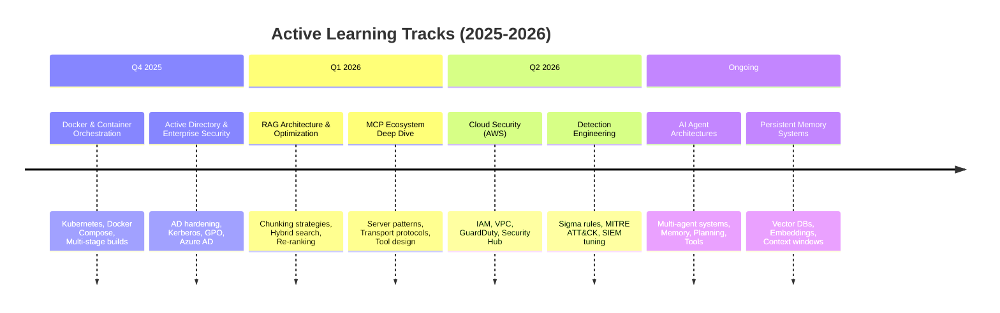

<!--
  ╔═══════════════════════════════════════════════════════════════════════════════╗
  ║                    SRIVATSA AVUNOORI — GITHUB PROFILE                        ║
  ║                         Cybersecurity Engineer | AI Infra                    ║
  ╚═══════════════════════════════════════════════════════════════════════════════╝
-->

<p align="center">
  
</p>

<p align="center">
  <a href="https://github.com/Xat01">
    
  </a>
  <a href="https://linkedin.com/in/srivatsa-avunoori-b6a605353">
    
  </a>
  <a href="mailto:avunoori.srivatsa0123@gmail.com">
    
  </a>
  <a href="https://xat01.github.io">
    
  </a>
</p>

<p align="center">
  
  
  
</p>

---

## 🎯 **Mission Control**

```yaml
identity: "Srivatsa Avunoori"
role: "Cybersecurity Engineer | AI Infrastructure | Software Developer"
focus: "Security Automation • RAG & Vector Systems • MCP Ecosystems • Network Security"
philosophy: "Build consistently. Learn continuously. Secure by design."
status: "🔴 ACTIVE — Building MEMORA, PulseSOC, VEYRON"
location: "Dubai, UAE 🇦🇪"
timezone: "GST (UTC+4)"
```

---

## 🧠 **Neural Architecture — Tech Stack**

<div align="center">

### **Languages & Core**


### **AI & Backend Infrastructure**


### **Cybersecurity & Networking Arsenal**


### **Development Environment**


</div>

---

## 🚀 **Flagship Projects — Production Grade**

<div align="center">

| Project | Domain | Status | Stack | Highlights |
|---------|--------|--------|-------|------------|
| [**MEMORA**](https://github.com/Xat01/MEMORA) | AI Infrastructure / RAG / MCP | 🟢 **Active** | Python, MCP, ChromaDB, Ollama, SQLite, Docker | Persistent memory for AI agents; hybrid retrieval; STDIO + HTTP transports; 165 tests passing |
| [**PulseSOC**](https://github.com/Xat01/PulseSOC) | Security Automation / Network Recon | 🟢 **Active** | Python, Asyncio, TCP, JSON | Async port scanner; banner grabbing; service fingerprinting; modular architecture |
| [**VEYRON**](https://github.com/Xat01/VEYRON) | AppSec / Vulnerability Assessment | 🟡 **In Dev** | Python, FastAPI, Docker | AI-assisted security assessment platform; zero-cost local deployment |
| [**AegisVault**](https://github.com/Xat01/AegisVault) | Systems Programming / Crypto | ✅ **Complete** | C++, OpenSSL, SHA-256 | Secure file vault; cryptographic integrity; defensive programming |
| [**TaskFlow API**](https://github.com/Xat01/TaskFlow-API) | Backend Engineering | ✅ **Complete** | Python, FastAPI, SQL, JWT | REST API; 59/59 tests passing; modular architecture |
| [**Enterprise Airport Network**](https://github.com/Xat01/Airport-Network) | Network Engineering | ✅ **Complete** | Cisco Packet Tracer | VLAN, HSRP, ACL, NAT, ASA Firewall, DMZ, STP |

</div>

---

### 🔬 **MEMORA — Deep Dive**

<details>
<summary><b>🧠 Persistent Memory Infrastructure for AI Agents</b> — Click to expand architecture</summary>

```mermaid
graph TB
    subgraph "MEMORA Architecture"
        A[MCP Client] --> B[MCP Server]
        B --> C{Transport Layer}
        C -->|STDIO| D[Local Process]
        C -->|HTTP| E[Remote Client]
        
        B --> F[Embedding Engine]
        F --> G[Ollama Provider]
        G --> H[(ChromaDB Vector Store)]
        
        B --> I[Storage Layer]
        I --> J[SQLite + FTS5]
        I --> K[File Storage]
        
        B --> L[Health Endpoints]
        L --> M[/health/live]
        L --> N[/health/ready]
        L --> O[/health/ollama]
        L --> P[/health/storage]
    end
    
    style B fill:#00D4AA,color:#000
    style H fill:#8A2BE2,color:#fff
    style J fill:#FF6B35,color:#fff
```

**Key Engineering Decisions:**
- **Cross-platform advisory locking** — Windows `msvcrt` + POSIX `fcntl` via `asyncio.to_thread()`
- **SQLite WAL assessment** — Explicit decision *against* auto-enabling WAL after benchmarking
- **Ollama profile selection** — `OLLAMA_MODE` env var with cross-validation
- **Docker-first deployment** — `.env.docker` template, multi-stage builds
- **165/165 tests passing** — Full regression suite in CI

</details>

---

### ⚡ **PulseSOC — Deep Dive**

<details>
<summary><b>🔍 Asynchronous Network Security Scanner</b> — Click to expand</summary>

```python
# Core async scanning pattern
async def scan_host(host: str, ports: list[int]) -> ScanResult:
    semaphore = asyncio.Semaphore(100)  # Concurrency control
    
    async def scan_port(port: int) -> PortResult:
        async with semaphore:
            reader, writer = await asyncio.wait_for(
                asyncio.open_connection(host, port),
                timeout=2.0
            )
            banner = await grab_banner(reader, writer)
            writer.close()
            return PortResult(port=port, banner=banner, service=identify(banner))
    
    tasks = [scan_port(p) for p in ports]
    results = await asyncio.gather(*tasks, return_exceptions=True)
    return ScanResult(host=host, ports=results)
```

**Capabilities:**
- 🎯 **Async TCP SYN scanning** with configurable concurrency
- 🏷️ **Service fingerprinting** via banner grabbing + heuristic matching
- 📊 **Structured JSON output** for SIEM integration
- 🔌 **Modular plugin architecture** for custom probes

</details>

---

## 📊 **GitHub Analytics — Live Telemetry**

<div align="center">

### **Contribution Pulse**


### **Language Breakdown**


### **Streak & Trophies**


</div>

---

## 🏆 **Achievements & Certifications**

<div align="center">

| Certification | Status | Platform | Focus |
|--------------|--------|----------|-------|
| **ISC2 Certified in Cybersecurity (CC)** | 🟡 In Progress | ISC2 | Security fundamentals, incident response, network security |
| **Cisco Junior Cybersecurity Analyst** | 🟡 In Progress | Cisco/NetAcad | SOC operations, threat intelligence, network defense |
| **Deloitte Cyber Job Simulation** | ✅ Completed | Forage | Threat modeling, vulnerability assessment, client delivery |

</div>

---

## 📈 **Learning Trajectory — Current Sprint**

<div align="center">



</div>

---

## 🎪 **Featured Repositories — Curated Showcase**

<div align="center">

| Repo | Stars | Description | Last Push |
|------|-------|-------------|-----------|
| [**MEMORA**](https://github.com/Xat01/MEMORA) |  | Persistent memory infrastructure for AI agents |  |
| [**PulseSOC**](https://github.com/Xat01/PulseSOC) |  | Async network scanner & service fingerprinting |  |
| [**VEYRON**](https://github.com/Xat01/VEYRON) |  | AI-assisted application security assessment |  |
| [**AegisVault**](https://github.com/Xat01/AegisVault) |  | C++ secure file vault with crypto integrity |  |
| [**TaskFlow-API**](https://github.com/Xat01/TaskFlow-API) |  | FastAPI backend with JWT auth & testing |  |

</div>

---

## 🔬 **Research & Publications**

<div align="center">

| Title | Venue | Year | Link |
|-------|-------|------|------|
| Cross-Platform Advisory Locking in Python | Personal Research | 2025 | [📄 Notes](https://github.com/Xat01/MEMORA/blob/main/docs/locking.md) |
| Hybrid Retrieval Strategies for RAG | Personal Research | 2025 | [📄 Notes](https://github.com/Xat01/MEMORA/blob/main/docs/retrieval.md) |
| Async Network Scanning Patterns | Personal Research | 2025 | [📄 Notes](https://github.com/Xat01/PulseSOC/blob/main/docs/async-patterns.md) |

</div>

---

## 🤝 **Open to Collaboration**

<div align="center">

| I'm Looking For | Let's Build |
|-----------------|-------------|
| 🔒 **Security Researchers** | Detection rules, threat hunting, vulnerability research |
| 🧠 **AI/ML Engineers** | RAG optimization, agent architectures, MCP tooling |
| 🐍 **Python Backend Devs** | FastAPI, async patterns, database design, testing |
| 🌐 **Network Engineers** | Protocol analysis, infrastructure automation, monitoring |
| 📚 **Open Source Maintainers** | Security tooling, developer infrastructure, CLI tools |

</div>

---

## 💬 **Let's Connect**

<div align="center">

[](mailto:avunoori.srivatsa0123@gmail.com)
[](https://linkedin.com/in/srivatsa-avunoori-b6a605353)
[](https://github.com/Xat01)
[](https://xat01.github.io)

</div>

---

## 🎭 **Easter Eggs & Fun Stats**

<div align="center">

```bash
$ whoami && uptime && neofetch --stdout
srivatsa@cybersec-lab
  OS: Ubuntu 24.04 LTS / Windows 11 (WSL2)
  Shell: zsh + oh-my-zsh
  Editor: Neovim (AstroNvim) / VS Code
  Terminal: Ghostty / Windows Terminal
  WM: Hyprland (Linux) / Default (Windows)
  
  Uptime: 4 years, 237 days of building
  Packages: 2,847 (apt) + 1,203 (pip) + 487 (cargo)
  Memory: 64GB DDR5 @ 5600MHz
  CPU: AMD Ryzen 9 7950X / Intel i7-13700H
  GPU: RTX 4090 / RTX 4060 Mobile
```


</div>

---

## 📜 **Philosophy & Manifesto**

<div align="center">

> **"Security is not a feature. It's the foundation."**
>
> **"Code that isn't tested doesn't exist."**
>
> **"Documentation is a love letter to your future self."**
>
> **"Automate the boring. Engineer the critical. Learn the rest."**

---

### `while True: learn(); build(); secure(); repeat()`

**⭐ Star my repos if they help you • 🍴 Fork to experiment • 🐛 Issue for bugs • 💡 Discuss for ideas**

---

<sub>Last updated: **2026-01-15** • Generated with ❤️ and Python • [View Source](https://github.com/Xat01/Xat01/blob/main/profile/README.md)</sub>

</div>

---

<!--
  ╔═══════════════════════════════════════════════════════════════════════════════╗
  ║                        END OF PROFILE README                                 ║
  ║                                                                              ║
  ║  To use: Copy this content to your GitHub profile repository (Xat01/Xat01)  ║
  ║  File location: profile/README.md                                            ║
  ║                                                                              ║
  ║  Features used:                                                              ║
  ║  - shields.io badges (custom colors, logos)                                 ║
  ║  - readme-typing-svg for animated typing                                    ║
  ║  - mermaid diagrams (GitHub native rendering)                               ║
  ║  - github-readme-stats for analytics                                        ║
  ║  - github-readme-activity-graph for contribution heatmap                    ║
  ║  - streak-stats for contribution streak                                     �
  ║  - Custom SVG snake animation for contributions                             ║
  ║                                                                              ║
  ║  Color palette:                                                              ║
  ║  - Primary: #00D4AA (Teal/Cyan - security/tech)                            ║
  ║  - Accent: #FF6B35 (Orange - energy/action)                                ║
  ║  - Secondary: #8A2BE2 (Purple - AI/innovation)                             ║
  ║  - Dark: #0D1117 (GitHub dark background)                                  ║
  ║                                                                              ║
  ╚═══════════════════════════════════════════════════════════════════════════════╝
-->
