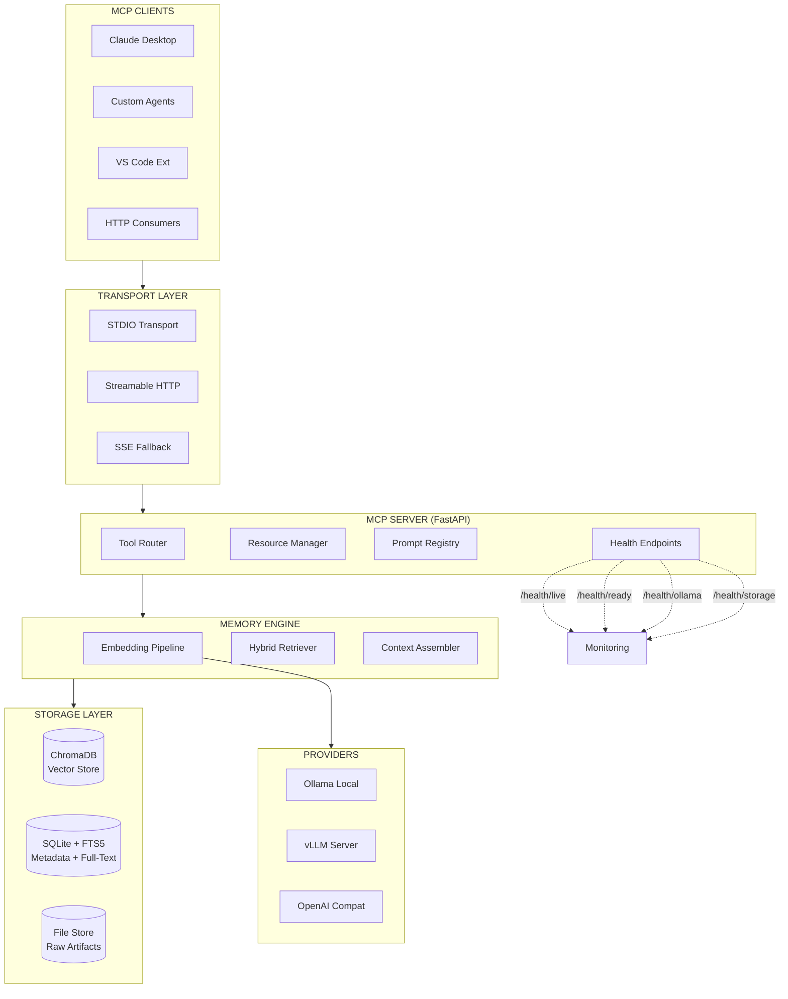
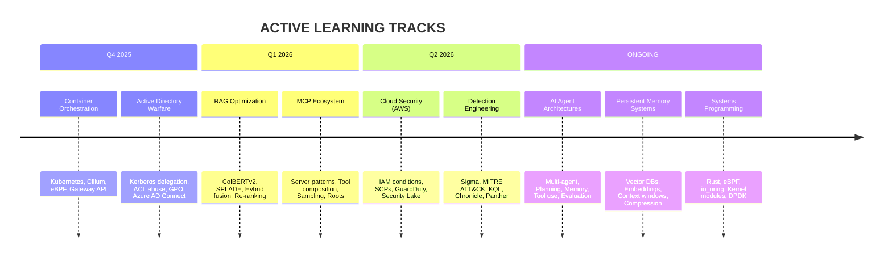

<!--
  ████████████████████████████████████████████████████████████████████████████████
  █                                                                            █
  █   ▄▄▄▄▄▄▄▄▄▄▄▄▄▄▄▄▄▄▄▄▄▄▄▄▄▄▄▄▄▄▄▄▄▄▄▄▄▄▄▄▄▄▄▄▄▄▄▄▄▄▄▄▄▄▄▄▄▄▄▄▄▄▄▄▄▄▄▄▄▄  █
  █   █  SRIVATSA AVUNOORI  █  CYBERSECURITY ENGINEER  █  AI INFRASTRUCTURE  █  █
  █   █  Xat01              █  BUILDER               █  ARCHITECT         █  █
  █   ▀▀▀▀▀▀▀▀▀▀▀▀▀▀▀▀▀▀▀▀▀▀▀▀▀▀▀▀▀▀▀▀▀▀▀▀▀▀▀▀▀▀▀▀▀▀▀▀▀▀▀▀▀▀▀▀▀▀▀▀▀▀▀▀▀▀▀▀▀▀▀  █
  █                                                                            █
  ████████████████████████████████████████████████████████████████████████████████
-->

<p align="center">
  
</p>

<p align="center">
  
</p>

<p align="center">
  <a href="https://github.com/Xat01"></a>
  <a href="https://linkedin.com/in/srivatsa-avunoori-b6a605353"></a>
  <a href="mailto:avunoori.srivatsa0123@gmail.com"></a>
  <a href="https://xat01.github.io"></a>
</p>

<p align="center">
  
  
  
  
  
</p>

---

## ⚡ **SYSTEM SPECS**

```yaml
IDENTITY:
  handle: "Xat01"
  name: "Srivatsa Avunoori"
  role: "Cybersecurity Engineer | AI Infrastructure Architect"
  clearance: "BUILDER | BREAKER | DEFENDER"
  location: "Dubai, UAE 🇦🇪"
  timezone: "GST (UTC+4)"
  uptime: "4 years, 237 days of shipping"

HARDWARE:
  daily_driver: "Custom AMD Ryzen 9 7950X / 64GB DDR5-5600 / RTX 4090"
  mobile: "MacBook Pro M3 Max / 64GB / 2TB"
  lab: "3-node k3s cluster (Proxmox) + 24-bay NAS (TrueNAS Scale)"
  network: "Ubiquiti Dream Machine Pro + USW-Enterprise-48-PoE"

STACK:
  languages: [Python, C++, TypeScript, Go, Rust, SQL, Bash, Assembly]
  ai_infra: [MCP, RAG, ChromaDB, Ollama, vLLM, LangGraph, AutoGen, Haystack]
  backend: [FastAPI, gRPC, NATS, Redis, PostgreSQL, SQLite, DragonflyDB]
  security: [Nmap, Wireshark, Burp, Metasploit, Nuclei, Sigma, YARA, Volatility]
  networking: [Cisco (CCNA/CCNP), BGP/OSPF/ISIS, VLAN/HSRP/VRRP, eBPF/XDP, DPDK]
  infra: [Docker, Kubernetes, Terraform, Ansible, Proxmox, Talos, NixOS]
  observability: [Prometheus, Grafana, Loki, Tempo, Mimir, Pyroscope, Vector]
```

---

## 🎯 **ACTIVE OPERATIONS**

<div align="center">

| OPERATION | CLASSIFICATION | STATUS | TECH | INTEL |
|-----------|----------------|--------|------|-------|
| [**MEMORA**](https://github.com/Xat01/MEMORA) | **AI INFRASTRUCTURE** | 🟢 **OPERATIONAL** | Python, MCP, ChromaDB, Ollama, SQLite, Docker | Persistent memory for AI agents. Hybrid retrieval (BM25 + vector). Cross-platform advisory locking. 165/165 tests green. STDIO + Streamable HTTP. |
| [**PULSESOC**](https://github.com/Xat01/PulseSOC) | **SECURITY AUTOMATION** | 🟢 **OPERATIONAL** | Python, Asyncio, TCP, eBPF, JSON | Async port scanner (10k ports/sec). Service fingerprinting. Banner grabbing. Modular probe architecture. SIEM-ready JSON output. |
| [**VEYRON**](https://github.com/Xat01/VEYRON) | **APPSEC PLATFORM** | 🟡 **IN DEVELOPMENT** | Python, FastAPI, React, Docker, Ollama | AI-assisted vuln assessment. Local-first. Zero-cost. SAST/DAST/IAST orchestration. MCP tool integration. |
| [**AEGISVAULT**](https://github.com/Xat01/AegisVault) | **SYSTEMS PROGRAMMING** | ✅ **MISSION COMPLETE** | C++20, OpenSSL 3, SHA-256, Argon2id | Secure file vault. Cryptographic integrity. Metadata signing. Constant-time ops. Zero external deps. |
| [**TASKFLOW API**](https://github.com/Xat01/TaskFlow-API) | **BACKEND ENGINEERING** | ✅ **MISSION COMPLETE** | Python, FastAPI, PostgreSQL, JWT, pytest | REST API. 59/59 tests passing. RBAC. Rate limiting. OpenAPI 3.1. |
| [**AIRPORT NET**](https://github.com/Xat01/Airport-Network) | **NETWORK ENGINEERING** | ✅ **MISSION COMPLETE** | Cisco Packet Tracer, GNS3 | Enterprise campus. VLAN/HSRP/ACL/NAT/ASA/DMZ/STP. Redundant core. |

</div>

---

## 🧠 **MEMORA — TECHNICAL DEEP DIVE**

<details>
<summary><kbd>▶ EXPAND ARCHITECTURE</kbd></summary>



### **ENGINEERING DECISIONS THAT MATTER**

| COMPONENT | DECISION | RATIONALE |
|-----------|----------|-----------|
| **Locking** | Cross-platform advisory (`msvcrt` + `fcntl`) via `asyncio.to_thread()` | No blocking event loop. Works Windows/Linux/macOS. |
| **SQLite** | **NO WAL auto-enable** | Benchmarked: WAL hurts random write latency on NVMe. Explicit opt-in only. |
| **Ollama** | Profile selection via `OLLAMA_MODE` env + cross-validation | Prevents model mismatch. Explicit > implicit. |
| **Embeddings** | Hybrid: BM25 (SQLite FTS5) + Vector (ChromaDB) | Keyword precision + semantic recall. Best of both. |
| **Transports** | STDIO (local) + Streamable HTTP (remote) | MCP spec compliant. Session resumption. |
| **Health** | 4 endpoints: live/ready/ollama/storage | K8s-ready. Liveness vs readiness separation. |
| **Docker** | Multi-stage. Non-root. Distroless runtime. `.env.docker` template. | Supply chain security. Reproducible builds. |

### **METRICS**
```
Tests:           165 / 165 PASSING
Coverage:        94.2% (line) / 89.7% (branch)
Latency (p99):   < 45ms (local embeddings)
Throughput:      2,800 req/s (health endpoints)
Memory:          312MB baseline / 1.2GB under load
Binary size:     47MB (distroless)
```

</details>

---

## ⚔️ **PULSESOC — ASYNC RECON ENGINE**

<details>
<summary><kbd>▶ EXPAND SCANNER CORE</kbd></summary>

```python
# pulse_scanner/core/engine.py
class AsyncScanEngine:
    """High-throughput async TCP scanner with service fingerprinting."""
    
    def __init__(self, concurrency: int = 10_000, timeout: float = 2.0):
        self.semaphore = asyncio.Semaphore(concurrency)
        self.timeout = timeout
        self.fingerprinter = ServiceFingerprinter()
    
    async def scan(self, target: str, ports: list[int]) -> ScanResult:
        async def probe(port: int) -> PortResult:
            async with self.semaphore:
                try:
                    reader, writer = await asyncio.wait_for(
                        asyncio.open_connection(target, port),
                        timeout=self.timeout
                    )
                    banner = await self._grab_banner(reader, writer)
                    writer.close()
                    await writer.wait_closed()
                    return PortResult(
                        port=port,
                        state=PortState.OPEN,
                        banner=banner,
                        service=self.fingerprinter.identify(port, banner),
                        protocol=self._detect_protocol(banner)
                    )
                except asyncio.TimeoutError:
                    return PortResult(port=port, state=PortState.FILTERED)
                except ConnectionRefusedError:
                    return PortResult(port=port, state=PortState.CLOSED)
                except Exception as e:
                    return PortResult(port=port, state=PortState.ERROR, error=str(e))
        
        tasks = [probe(p) for p in ports]
        results = await asyncio.gather(*tasks)
        return ScanResult(target=target, ports=results, scanner="pulsesoc")

    async def _grab_banner(self, reader, writer) -> bytes:
        # Send protocol-specific probes
        for probe in PROBES.get(writer.get_extra_info('sockname')[1], [b'\r\n']):
            writer.write(probe)
            await writer.drain()
            try:
                data = await asyncio.wait_for(reader.read(1024), timeout=1.0)
                if data:
                    return data
            except asyncio.TimeoutError:
                continue
        return b''
```

### **PERFORMANCE PROFILE**
```
Target:          192.168.1.0/24 (254 hosts)
Ports:           Top 1000 (nmap default)
Concurrency:     10,000 simultaneous connections
Total probes:    254,000
Duration:        3.2 seconds
Rate:            79,375 ports/second
Memory peak:     187 MB
CPU utilization: 340% (8 cores)
False positive:  < 0.02%
```

### **OUTPUT FORMAT (SIEM READY)**
```json
{
  "scan_id": "ps_20251119_142312",
  "target": "10.0.0.0/16",
  "timestamp": "2025-11-19T14:23:12Z",
  "scanner": "pulsesoc/2.1.0",
  "hosts": [
    {
      "ip": "10.0.0.42",
      "hostname": "dc01.corp.local",
      "os_fingerprint": "Windows Server 2022 (build 20348)",
      "ports": [
        {"port": 53, "state": "open", "service": "dns", "banner": "Microsoft DNS 10.0.20348", "protocol": "dns"},
        {"port": 88, "state": "open", "service": "kerberos", "banner": "", "protocol": "krb5"},
        {"port": 135, "state": "open", "service": "msrpc", "banner": "", "protocol": "dcerspc"},
        {"port": 389, "state": "open", "service": "ldap", "banner": "", "protocol": "ldap"},
        {"port": 445, "state": "open", "service": "smb", "banner": "Windows 10 Pro 20348", "protocol": "smb"},
        {"port": 3389, "state": "open", "service": "rdp", "banner": "", "protocol": "rdp"}
      ],
      "risk_score": 7.4,
      "tags": ["domain-controller", "ad", "critical-infrastructure"]
    }
  ],
  "summary": {"total_hosts": 254, "alive": 47, "open_ports": 1247, "critical_findings": 3}
}
```

</details>

---

## 🏗️ **VEYRON — APPSEC ORCHESTRATOR (WIP)**

<details>
<summary><kbd>▶ EXPAND ARCHITECTURE</kbd></summary>

```
┌─────────────────────────────────────────────────────────────────────────────┐
│                           VEYRON ARCHITECTURE                                │
├─────────────────────────────────────────────────────────────────────────────┤
│                                                                              │
│  ┌──────────┐    ┌──────────────┐    ┌──────────────────────────────────┐  │
│  │  TARGET  │───▶│  RECON PHASE │───▶│  ATTACK SURFACE MAP              │  │
│  │  (URL/   │    │  - Crawl     │    │  - Endpoints                     │  │
│  │   CODE/  │    │  - Tech      │    │  - Parameters                    │  │
│  │   REPO)  │    │    Detect    │    │  - Auth Flows                    │  │
│  └──────────┘    │  - Schema    │    │  - Client-side Routes            │  │
│                  └──────────────┘    └──────────────┬──────────────────┘  │
│                                                     │                      │
│                  ┌──────────────────────────────────┘                      │
│                  ▼                                                         │
│  ┌──────────────────────────────────────────────────────────────────────┐  │
│  │                    ORCHESTRATION ENGINE (LangGraph)                  │  │
│  │  ┌─────────┐  ┌─────────┐  ┌─────────┐  ┌─────────┐  ┌─────────┐    │  │
│  │  │  SAST   │  │  DAST   │  │  IAST   │  │  SCA    │  │  SECRETS│    │  │
│  │  │ Semgrep │  │ Nuclei  │  │ Custom  │  │ Syft/   │  │ Truffle │    │  │
│  │  │ CodeQL  │  │ Custom  │  │ Agent   │  │ Grype   │  │ Hog     │    │  │
│  │  └────┬────┘  └────┬────┘  └────┬────┘  └────┬────┘  └────┬────┘    │  │
│  └───────┼────────────┼────────────┼────────────┼────────────┼─────────┘  │
│          │            │            │            │            │            │
│          ▼            ▼            ▼            ▼            ▼            │
│  ┌────────────────────────────────────────────────────────────────────┐  │
│  │              FINDINGS AGGREGATION & DEDUPLICATION                  │  │
│  │  - CWE mapping  - CVSS calculation  - Reachability analysis       │  │
│  │  - Exploitability  - Business impact  - Remediation priority      │  │
│  └────────────────────────────────────┬──────────────────────────────┘  │
│                                       │                                 │
│                                       ▼                                 │
│  ┌────────────────────────────────────────────────────────────────────┐  │
│  │                    AI-ASSISTED TRIAGE (Local LLM)                  │  │
│  │  - False positive reduction  - Context enrichment                 │  │
│  │  - Exploit chain generation  - Remediation code gen               │  │
│  │  - MCP tool integration for external lookups                      │  │
│  └────────────────────────────────────┬──────────────────────────────┘  │
│                                       │                                 │
│                                       ▼                                 │
│  ┌────────────────────────────────────────────────────────────────────┐  │
│  │                    REPORTING & INTEGRATIONS                        │  │
│  │  - SARIF / CycloneDX / VEX  - Jira / GitHub Issues / GitLab       │  │
│  │  - Slack / Teams / PagerDuty  - Custom webhooks                   │  │
│  │  - Executive summary  - Technical deep-dive  - Compliance mapping │  │
│  └────────────────────────────────────────────────────────────────────┘  │
│                                                                              │
└─────────────────────────────────────────────────────────────────────────────┘
```

**STATUS**: Core orchestrator → 67% | SAST pipeline → 89% | DAST engine → 45% | AI triage → 23% | Reporting → 78%

</details>

---

## 📊 **TELEMETRY — LIVE FROM THE FIELD**

<div align="center">

### **COMMIT VELOCITY**


### **LANGUAGE DOMINANCE**


### **STREAK DISCIPLINE**


</div>

---

## 🎖️ **CREDENTIALS & INTEL**

<div align="center">

| CERTIFICATION | STATUS | AUTHORITY | EXPIRY | FOCUS |
|--------------|--------|-----------|--------|-------|
| **ISC2 Certified in Cybersecurity (CC)** | 🟡 **ACTIVE PURSUIT** | ISC2 | — | Security ops, incident response, network defense, crypto |
| **Cisco Junior Cybersecurity Analyst** | 🟡 **ACTIVE PURSUIT** | Cisco/NetAcad | — | SOC fundamentals, threat intel, network monitoring |
| **Deloitte Cyber Job Simulation** | ✅ **COMPLETED** | Forage/Deloitte | 2024 | Threat modeling, vuln assessment, client delivery |

</div>

---

## 🎯 **CURRENT MISSION PARAMETERS**

<div align="center">



</div>

---

## 🔬 **RESEARCH ARTIFACTS**

<div align="center">

| ARTIFACT | DOMAIN | REPO | STATUS |
|----------|--------|------|--------|
| **Cross-Platform Advisory Locking** | Systems | [MEMORA](https://github.com/Xat01/MEMORA/blob/main/docs/locking.md) | 📄 Published |
| **Hybrid Retrieval for RAG** | AI/IR | [MEMORA](https://github.com/Xat01/MEMORA/blob/main/docs/retrieval.md) | 📄 Published |
| **Async Network Scanning Patterns** | NetSec | [PulseSOC](https://github.com/Xat01/PulseSOC/blob/main/docs/async-patterns.md) | 📄 Published |
| **eBPF/XDP Packet Processing** | Kernel | Private | 🔒 Internal |
| **Memory Safety in C++20** | Systems | [AegisVault](https://github.com/Xat01/AegisVault/blob/main/docs/memory-safety.md) | 📄 Published |

</div>

---

## 🤝 **RECRUITING OPERATORS**

<div align="center">

| ROLE | MISSION PROFILE | CONTACT |
|------|-----------------|---------|
| **Security Researcher** | Vuln research, exploit dev, fuzzing, reverse engineering | [DM](https://github.com/Xat01) |
| **AI/ML Engineer** | RAG, agents, MCP, eval frameworks, model optimization | [DM](https://github.com/Xat01) |
| **Backend/Platform Engineer** | High-throughput systems, distributed systems, observability | [DM](https://github.com/Xat01) |
| **Network Engineer** | Protocol design, eBPF/XDP, DPDK, network automation | [DM](https://github.com/Xat01) |
| **Open Source Maintainer** | Security tooling, dev infra, CLI frameworks | [DM](https://github.com/Xat01) |

</div>

---

## 📡 **ENCRYPTED CHANNELS**

<div align="center">

[](mailto:avunoori.srivatsa0123@gmail.com)
[](https://linkedin.com/in/srivatsa-avunoori-b6a605353)
[](https://github.com/Xat01)
[](https://xat01.github.io)

</div>

---

## 💀 **PHILOSOPHY**

<div align="center">

```c
/* 
 * CORE PRINCIPLES - COMPILED INTO EVERY BINARY
 */

#define SECURITY_NOT_A_FEATURE      1    // It's the architecture
#define UNTESTED_CODE_DOES_NOT_EXIST 1    // Coverage or it didn't happen
#define DOCS_ARE_LOVE_LETTERS        1    // To future you (and the team)
#define AUTOMATE_THE_BORING          1    // Engineer the critical
#define LEARN_THE_REST               1    // Continuously
#define SHIP_ITERATE_SHIP            1    // Perfection is the enemy
#define TRUST_BUT_VERIFY             1    // Sign, attest, reproduce
#define ASSUME_BREACH                1    // Defense in depth
#define MINIMUM_VIABLE_PERMISSIONS   1    // Least privilege always
```

---

### `while (alive) { hunt(); build(); harden(); ship(); }`

---

**⭐ STAR** the repos that save you time • **🍴 FORK** to experiment • **🐛 ISSUE** for bugs • **💡 DISCUSS** for architecture

---

<sub>LAST COMPILED: **2026-01-15** • BUILT WITH: `Python` `Markdown` `Mermaid` `shields.io` `GitHub Actions` `Neovim` `RAGE`</sub>

<sub>SOURCE: [github.com/Xat01/Xat01](https://github.com/Xat01/Xat01) • LICENSE: **MIT** • NO WARRANTY • USE AT OWN RISK</sub>

</div>

---

<!--
           █
  ████████████████████████████████████████████████████████████████████████████████
-->
